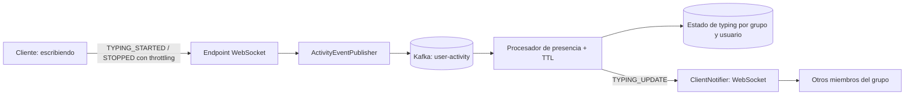
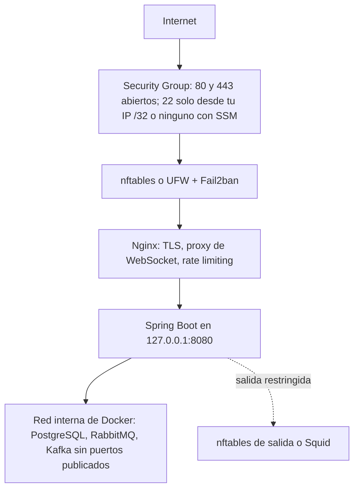
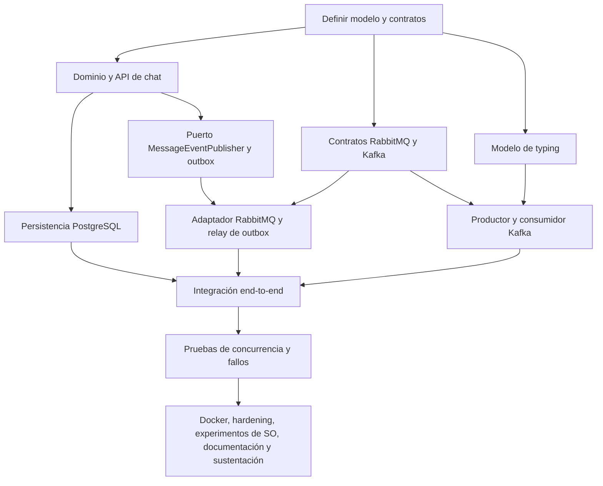

# Plan de trabajo colaborativo — Stream-Chat (v2, revisado)

**Equipo:** 3 programadores  
**Proyecto:** Stream-Chat  
**Asignaturas:** Programación Orientada a Objetos (POO), Sistemas Distribuidos y Sistemas Operativos  
**Arquitectura propuesta:** Spring Boot + WebSocket + RabbitMQ + Kafka + PostgreSQL + Docker  
**Modalidad de trabajo:** desarrollo por módulos, contratos definidos e integración progresiva.

> **Qué cambia en la v2:** se corrige el flujo de arquitectura (secciones 2 y 4), se revisa SOLID y se evalúan los patrones del catálogo GoF (sección 8), se incorpora la **gestión de recursos del SO** que indican las presentaciones (sección 9) y el **despliegue seguro** con hardening (sección 10). El Anexo A resume cada cambio.

---

## 1. Objetivo del plan

Dividir Stream-Chat en tres módulos con responsabilidades claras para que cada programador pueda avanzar de forma independiente, sin duplicar lógica ni modificar constantemente el código de los demás.

La división propuesta es:

1. **Programador 1 — Backend de chat y dominio:** usuarios, grupos, mensajes, reglas de negocio, persistencia e interfaz WebSocket/REST.
2. **Programador 2 — Mensajería distribuida:** RabbitMQ, Kafka, publicación y consumo de eventos, confiabilidad y control de duplicados.
3. **Programador 3 — Estado de presencia, infraestructura y operación:** eventos de typing, estado de usuarios, Docker, configuración, observabilidad y pruebas de concurrencia.

Los tres deben acordar primero los contratos de integración. La división es por responsabilidad técnica, no por asignatura: cada módulo debe aportar evidencias para las tres materias.

## 2. Arquitectura general y flujo

> **Corrección v2:** el diagrama de la v1 encadenaba en una sola línea dos flujos distintos (mensajes y actividad de *typing*). Los mensajes aparecían pasando por Kafka y el procesador de typing, y no quedaba claro quién entrega el mensaje a los demás clientes. Ahora son dos flujos separados que comparten el mismo notificador WebSocket.

### 2.1 Flujo de mensajes (fiable y persistente)

```mermaid
flowchart LR
    C1["Cliente WebSocket / REST"] -->|"1. enviar mensaje"| API["API Spring Boot"]
    API --> UC["Caso de uso SendMessage"]
    UC -->|"2. misma transacción"| DB[("PostgreSQL: messages + outbox")]
    DB -->|"3. lee outbox pendiente"| REL["Relay de outbox"]
    REL -->|"4. publica con publisher confirm"| RMQ["RabbitMQ: exchange topic"]
    RMQ -->|"5. ACK manual"| CON["Consumidor idempotente"]
    CON -->|"6. MESSAGE_NEW"| GW["ClientNotifier: WebSocket"]
    GW --> C2["Miembros conectados del grupo"]
    RMQ -.->|"reintentos agotados"| DLQ["Dead Letter Queue"]
```



### 2.2 Flujo de actividad (typing y presencia, efímero)



### 2.3 Responsabilidad de cada tecnología

| Tecnología | Responsabilidad dentro del proyecto |
|---|---|
| Spring Boot | API, casos de uso, configuración e integración de componentes |
| WebSocket | Comunicación en tiempo real entre servidor y clientes |
| PostgreSQL | Persistencia de usuarios, grupos y mensajes; fuente de verdad del historial; tabla `outbox` y tabla de eventos procesados |
| RabbitMQ | Transporte fiable de eventos de mensajes (ACK, reintentos, DLQ), como cola de trabajo |
| Kafka | Flujo de eventos de actividad, como `TYPING_STARTED` y `TYPING_STOPPED`, con retención corta |
| Docker Compose | Entorno local reproducible para ejecutar los servicios |
| Nginx | Único punto público: TLS, proxy de WebSocket, rate limiting (ver sección 10) |
| nftables / UFW + Fail2ban | Firewall de host y bloqueo de IPs agresivas (ver sección 10) |
| JUnit / Mockito / ArchUnit | Pruebas unitarias, de integración y de arquitectura |

**Decisión importante:** RabbitMQ y Kafka no reemplazan a PostgreSQL como historial permanente. RabbitMQ transporta mensajes; Kafka conserva eventos durante un periodo configurable. El historial del chat debe consultarse desde PostgreSQL.

### 2.4 Decisiones de arquitectura que corrige la v2 (documentar como ADR en `docs/decisions/`)

1. **Patrón Outbox (problema de doble escritura).** En la v1, guardar en PostgreSQL y publicar en RabbitMQ eran dos operaciones independientes. Si el proceso cae entre ambas, el mensaje queda guardado pero nunca se distribuye. Solución: el caso de uso guarda el mensaje **y** una fila en `outbox` en la misma transacción; un relay publica las filas pendientes con *publisher confirm* y las marca como enviadas.
2. **Entrega al menos una vez + consumidor idempotente.** No se promete *exactly once*. Cada consumidor registra el `eventId` en una tabla de eventos procesados (con restricción única) antes de producir efectos.
3. **Justificación escrita de usar dos brokers.** RabbitMQ para comandos y eventos de mensaje que necesitan ACK, reintentos y DLQ. Kafka para un flujo de alto volumen, efímero y reproducible (actividad). Si el equipo no puede justificarlo con estos argumentos, es señal de que uno de los dos sobra; documentarlo igualmente.
4. **Fan-out con varias instancias.** Un evento de typing debe llegar a la instancia que tiene conectado a cada miembro del grupo. Opciones: un `group.id` de Kafka distinto por instancia (cada una lee todo y filtra por sus sesiones) o un almacén compartido. Para la versión académica de una sola instancia, documentar la limitación.
5. **Identidad desde el token.** El `senderId` y el `userId` salen de la autenticación (handshake WebSocket y REST), nunca del cuerpo del mensaje.

---

## 3. División de responsabilidades

> **Nota de equilibrio (v2):** el Programador 1 está en la ruta crítica (dominio, API, autenticación, persistencia y WebSocket). Si se retrasa, mover al Programador 3 el adaptador WebSocket (sesiones y *heartbeats*), manteniendo el puerto `ClientNotifier` como contrato.

## Programador 1 — Dominio, API y persistencia del chat

**Responsable de:** funcionalidad principal del chat y reglas del negocio.

### Tareas

- Definir el modelo de dominio:
  - `User`
  - `ChatGroup`
  - `GroupMember`
  - `ChatMessage`
  - `MessageId`
  - `UserId`
  - `GroupId`
- Implementar reglas de negocio:
  - Crear y consultar usuarios.
  - Crear grupos.
  - Agregar o retirar integrantes.
  - Validar que solo un integrante pueda enviar mensajes al grupo.
  - Enviar mensajes y consultar el historial.
- Crear endpoints REST necesarios.
- Implementar la conexión y los controladores WebSocket del chat.
- Crear repositorios e integración con PostgreSQL.
- Definir DTO de entrada y salida; no exponer entidades JPA directamente.
- Implementar validaciones y manejo uniforme de errores.
- Escribir pruebas unitarias de los casos de uso y pruebas de repositorio.

### Ajustes de la revisión (v2)

- Modelar `ChatGroup` como raíz de agregado: `sendMessage(userId, content)` valida la pertenencia y devuelve un `ChatMessage`. La regla vive en el dominio, no en el controlador.
- Autenticación y autorización: validar el token en el handshake WebSocket y en REST. El `senderId` sale de la identidad autenticada, nunca del cuerpo del mensaje.
- Límites y validación: tamaño máximo de mensaje, rate limit por usuario y escape del contenido. Pipeline de validación con Chain of Responsibility.
- Guardar el mensaje y una fila de `outbox` en la misma transacción (sección 2.4). P1 define el puerto `MessageEventPublisher`; P2 implementa el adaptador y el relay.
- Ser dueño único del adaptador WebSocket (`ClientNotifier`): registro de sesiones, handshake, *heartbeats* y buffer acotado por sesión con política para clientes lentos. P2 y P3 usan el puerto y no abren otro endpoint.
- Inyectar un `Clock` para probar reglas que dependen del tiempo sin esperas reales.
- Experimentos de SO: E3 (journaling y WAL) y la parte de fugas de memoria de E2; gestores de archivos y de memoria (secciones 9.2 y 9.3).

**Criterios de aceptación adicionales**

- El `senderId` de un mensaje es el del usuario autenticado; un token ausente o inválido se rechaza.
- El mensaje y su fila de `outbox` se confirman o se revierten juntos.
- Un cliente lento no bloquea el envío a los demás ni hace crecer la memoria sin límite.

### Entregables

- Diagrama de clases del dominio.
- Diagrama entidad-relación de PostgreSQL.
- Migraciones SQL o herramienta de migración acordada.
- API REST documentada.
- Casos de uso de creación de grupo, envío y consulta de mensajes.
- Pruebas automatizadas del módulo.

### Estructura sugerida

```text
chat-service/
└── src/main/java/com/streamchat/
    ├── domain/
    │   ├── model/
    │   ├── valueobject/
    │   └── repository/
    ├── application/
    │   ├── usecase/
    │   └── dto/
    └── infrastructure/
        ├── persistence/
        ├── rest/
        └── websocket/
```

### Criterios de aceptación

- Un usuario no puede enviar mensajes a un grupo al que no pertenece.
- Cada mensaje tiene un identificador único y fecha de creación.
- Los mensajes se guardan en PostgreSQL antes de considerarse persistidos.
- El historial puede consultarse por grupo con paginación y orden estable.
- Las reglas del dominio se prueban sin levantar RabbitMQ ni Kafka.

---

## Programador 2 — RabbitMQ, Kafka y procesamiento distribuido

**Responsable de:** transporte y procesamiento asíncrono de mensajes y eventos.

### Tareas

- Configurar RabbitMQ:
  - Exchange de tipo `topic` para enrutar eventos de mensajes.
  - Colas y bindings por tipo de consumidor.
  - ACK manual.
  - Publisher confirms.
  - Dead Letter Exchange (DLX) y política de reintentos.
- Definir el contrato del evento de mensaje.
- Implementar el publicador y consumidor de mensajes.
- Configurar Kafka:
  - Topic `user-activity` o nombre acordado.
  - Clave de partición estable, por ejemplo `groupId:userId`.
  - Productor y consumidor.
  - Manejo de offsets y errores.
- Implementar idempotencia para evitar procesar dos veces el mismo evento.
- Añadir trazabilidad mediante `eventId`, `correlationId` y marcas de tiempo.
- Preparar pruebas de integración para fallos, reintentos y duplicados.

### Contrato inicial del evento

Todos deben usar el mismo contrato. Propuesta:

```json
{
  "eventId": "uuid",
  "eventType": "MESSAGE_CREATED",
  "messageId": "uuid",
  "groupId": "uuid",
  "senderId": "uuid",
  "content": "Hola equipo",
  "createdAt": "2026-11-15T15:00:00Z",
  "correlationId": "uuid"
}
```

Para actividad de usuario:

```json
{
  "eventId": "uuid",
  "eventType": "TYPING_STARTED",
  "groupId": "uuid",
  "userId": "uuid",
  "occurredAt": "2026-11-15T15:00:00Z",
  "correlationId": "uuid"
}
```

Los nombres y campos deben congelarse en una reunión inicial. Si se modifica un contrato, se actualiza la versión y se avisa a los otros dos programadores.

### Ajustes de la revisión (v2)

- Implementar el relay de outbox: leer eventos pendientes, publicar con *publisher confirm*, marcarlos como enviados y reintentar si falla.
- Crear la tabla de eventos procesados (`eventId` único) para la idempotencia y una clase base `AbstractIdempotentConsumer` (Template Method): deduplicar, procesar, ACK o NACK.
- Envolver el publicador con decoradores (registro, métricas, reintento) en vez de mezclar esas responsabilidades en un solo adaptador.
- Añadir `schemaVersion` a todos los eventos y mantener los JSON de ejemplo y las pruebas de contrato en `contracts`.
- Reintentos con espera creciente (colas de reintento con TTL) antes de enviar a la DLQ.
- Ajustar el *prefetch* de RabbitMQ y confirmar los offsets de Kafka solo después de procesar.
- Configurar el topic de actividad con retención corta: los eventos de typing son efímeros.
- No publicar los puertos de PostgreSQL, RabbitMQ ni Kafka; las credenciales van por variables de entorno.
- Experimentos de SO: E4 y E5, y parte de E6; gestor de E/S (sección 9.4).

**Criterios de aceptación adicionales**

- Si el proceso cae entre el guardado y la publicación, el evento se publica al recuperarse.
- Los offsets de Kafka se confirman después de procesar el evento.
- Los puertos de los brokers y de la base de datos no son alcanzables desde fuera del servidor.

### Entregables

- Diagrama de exchanges, colas, topics y consumidores.
- Configuración RabbitMQ y Kafka.
- Productores y consumidores implementados.
- Política documentada de ACK, reintentos y mensajes fallidos.
- Pruebas de publicación, consumo, reintento e idempotencia.
- Evidencia de procesamiento correcto ante una caída temporal del consumidor.

### Estructura sugerida

```text
messaging/
└── src/main/java/com/streamchat/messaging/
    ├── contract/
    ├── rabbitmq/
    │   ├── config/
    │   ├── publisher/
    │   └── consumer/
    ├── kafka/
    │   ├── config/
    │   ├── producer/
    │   └── consumer/
    └── application/
```

### Criterios de aceptación

- El productor confirma la publicación antes de reportarla como aceptada por el broker.
- Los consumidores usan ACK manual cuando corresponda.
- Los mensajes que fallan repetidamente llegan a una cola de mensajes fallidos.
- Un mismo `eventId` no produce efectos de negocio duplicados.
- El sistema tolera una desconexión temporal del consumidor y procesa los mensajes pendientes al recuperarse.
- La clave de partición permite mantener el orden requerido por usuario/grupo, sin asumir orden global entre todas las particiones.

---

## Programador 3 — Typing, presencia, infraestructura y operación

**Responsable de:** actividad en tiempo real, estado temporal de usuarios y ejecución reproducible del sistema.

### Tareas

- Implementar eventos:
  - `TYPING_STARTED`
  - `TYPING_STOPPED`
- Consumir eventos de actividad desde Kafka.
- Mantener el estado de escritura por combinación de grupo y usuario.
- Implementar expiración automática del estado:
  - Si no llega un evento de actividad dentro del tiempo definido, el usuario deja de aparecer escribiendo.
  - La expiración debe funcionar aunque no llegue un evento explícito `TYPING_STOPPED`.
- Definir estrategia compatible con múltiples instancias:
  - Evitar depender exclusivamente de un `Map` en memoria.
  - Para una versión académica de una sola instancia, documentar la limitación.
  - Para escalar, usar un almacén compartido o un procesador de streams con estado persistente.
- Distribuir actualizaciones de presencia a los clientes WebSocket.
- Preparar Dockerfile y Docker Compose.
- Configurar variables de entorno, health checks y límites de recursos.
- Añadir logs estructurados y métricas básicas.
- Ejecutar pruebas de concurrencia y documentar resultados.

### Ajustes de la revisión (v2)

- Aplicar *throttling* en el cliente: `TYPING_STARTED` como máximo cada pocos segundos, que además sirve de *heartbeat*. El estado expira si no se renueva (TTL configurable y `Clock` inyectado).
- Guardar el estado en estructuras concurrentes con operaciones atómicas; nada de `Map` estático ni bloqueos globales.
- Enviar las notificaciones de presencia por el puerto `ClientNotifier` de P1.
- Decidir y documentar la estrategia de fan-out entre instancias (sección 2.4, punto 4).
- Exponer métricas: `typing_states_active` y latencia de `TYPING_UPDATE`.
- Configurar *health checks*, política de reinicio y límites de CPU y memoria en Compose.
- Responsable del despliegue seguro (sección 10) y de los experimentos E1, E2 y E6 (sección 9).

**Criterios de aceptación adicionales**

- Tras una ráfaga de eventos, el número de estados de typing activos vuelve a cero.
- Matar un servicio con `kill -9` provoca su reinicio automático y queda documentado el tiempo de recuperación.
- La instancia desplegada cumple la checklist mínima de la sección 10.

### Entregables

- Diagrama de estados de typing.
- Procesador de eventos de actividad.
- Mecanismo de expiración.
- Notificaciones WebSocket de presencia.
- `Dockerfile` y `compose.yaml`.
- Guía de arranque del proyecto.
- Pruebas de expiración, concurrencia y recuperación.

### Estructura sugerida

```text
presence-infrastructure/
├── src/main/java/com/streamchat/presence/
│   ├── domain/
│   ├── application/
│   ├── kafka/
│   └── websocket/
├── Dockerfile
└── compose.yaml
```

### Criterios de aceptación

- Al iniciar la escritura, los integrantes del grupo reciben la notificación.
- Al detenerse la escritura o expirar el tiempo, se elimina el estado.
- Dos usuarios pueden escribir simultáneamente sin sobrescribir sus estados.
- El sistema no depende de una variable estática compartida para coordinar instancias.
- El entorno se levanta siguiendo una guía única y sin configuraciones manuales ocultas.

---

## 4. Contratos entre módulos: cómo trabajar en paralelo

La integración debe basarse en contratos acordados, no en que un programador conozca los detalles internos del otro módulo.

> **Corrección v2:** en la v1 la interfaz `MessagePublisher` vivía en el módulo compartido `contracts`. Eso obliga al dominio a depender de una librería compartida y contradice la inversión de dependencias: **la abstracción pertenece a quien la usa, no a quien la implementa.** Ahora `contracts` contiene solo datos versionados (eventos y DTO) y los **puertos** viven en el módulo que los necesita.

| Contrato | Dónde vive | Lo define | Lo implementa / consume |
|---|---|---|---|
| `MessageCreatedEvent` (versión 1) | `contracts` | Programadores 1 y 2 | P2 publica y consume; P1 lo usa para notificar |
| `UserActivityEvent` (`TYPING_STARTED`, `TYPING_STOPPED`, versión 1) | `contracts` | Programadores 2 y 3 | P3 produce y procesa; P2 integra Kafka |
| Puerto `MessageEventPublisher` | `chat/application/port/out` | P1 (es quien lo usa) | P2 implementa el adaptador (outbox + RabbitMQ) |
| Puerto `ActivityEventPublisher` | `presence/application/port/out` | P3 (es quien lo usa) | P2 implementa el adaptador Kafka |
| Puerto `ClientNotifier` | `chat/application/port/out` | P1 | P1 implementa el adaptador WebSocket; P2 y P3 lo **usan**, no abren otro endpoint |
| API de consulta de historial | REST | Programador 1 | Cliente y pruebas de integración |
| Mensajes WebSocket cliente-servidor (`MESSAGE_NEW`, `TYPING_UPDATE`, errores) | `contracts` | Programadores 1 y 3 | Cliente |

### Reglas obligatorias de integración

1. Los contratos DTO/eventos se acuerdan antes de implementar las integraciones.
2. `contracts` es un módulo pequeño, sin lógica y sin Spring: solo registros/DTO y sus esquemas JSON.
3. Todo evento lleva `schemaVersion`. Un cambio compatible suma campos opcionales; uno incompatible crea una versión nueva y se coordina antes de fusionar.
4. No importar clases internas de otro módulo; depender de puertos y contratos.
5. No compartir entidades JPA entre módulos.
6. Cada módulo debe poder probarse con dobles de prueba sin depender de todos los servicios externos.
7. **Pruebas de contrato:** los JSON de ejemplo viven en `contracts/src/test/resources` y se serializan y deserializan en las pruebas de cada módulo. La misma suite de pruebas se ejecuta contra el `Fake` y contra el adaptador real de cada puerto (así se verifica LSP).
8. Un único dueño por componente transversal: WebSocket (P1), topología RabbitMQ/Kafka (P2), Docker/compose (P3).

### Interfaces de ejemplo

```java
// chat/application/port/out/MessageEventPublisher.java
public interface MessageEventPublisher {
    // Implementación real: inserta en la tabla outbox dentro de la transacción en curso.
    void publish(MessageCreatedEvent event);
}

// chat/application/port/out/ClientNotifier.java
public interface ClientNotifier {
    void notifyGroup(GroupId groupId, ServerEvent event);
}
```

El caso de uso del chat depende de `MessageEventPublisher`, no de una clase concreta de RabbitMQ ni de la tabla `outbox`. Así se aplica el principio de inversión de dependencias (DIP).

---

## 5. Estructura general del repositorio

Para un equipo de tres y un proyecto académico, se recomienda comenzar con un **monolito modular** (una sola aplicación Spring Boot). Permite separar responsabilidades sin asumir desde el principio el costo operativo de microservicios. RabbitMQ y Kafka siguen siendo componentes externos.

> **Corrección v2:** las estructuras `chat-service/`, `messaging/` y `presence-infrastructure/` de la sección 3 son **ilustrativas**. En el monolito modular equivalen a los paquetes `chat`, `messaging` y `presence` del árbol siguiente. La v1 mezclaba ambos enfoques sin aclararlo.

```text
stream-chat/
├── docs/
│   ├── architecture/
│   ├── diagrams/
│   ├── api/
│   ├── decisions/             # ADR: outbox, brokers, fan-out, identidad
│   ├── so/                    # informe de gestión de recursos (sección 9)
│   └── security/              # checklist de hardening y runbook de incidentes
├── contracts/                 # solo eventos/DTO versionados, sin lógica ni Spring
│   └── src/main/java/com/streamchat/contracts/
├── src/
│   ├── main/java/com/streamchat/
│   │   ├── chat/
│   │   │   ├── domain/
│   │   │   ├── application/
│   │   │   │   ├── usecase/
│   │   │   │   └── port/      # in / out
│   │   │   └── infrastructure/  # persistence, rest, websocket
│   │   ├── messaging/
│   │   │   ├── rabbitmq/
│   │   │   ├── kafka/
│   │   │   └── outbox/
│   │   ├── presence/
│   │   │   ├── domain/
│   │   │   ├── application/
│   │   │   └── infrastructure/
│   │   └── shared/
│   └── test/java/com/streamchat/   # incluye pruebas de arquitectura (ArchUnit)
├── infra/
│   ├── docker/
│   ├── nginx/
│   ├── nftables/              # nftables.conf validado con `nft -c`
│   ├── systemd/               # MemoryMax, CPUQuota si se despliega sin Docker
│   └── monitoring/            # check-resources.sh, config de CloudWatch Agent
├── compose.yaml
├── Dockerfile
├── .env.example
├── .gitignore
├── README.md
└── pom.xml
```

### Reglas de arquitectura que se verifican automáticamente (ArchUnit o Spring Modulith)

- `chat.domain` y `presence.domain` no importan `org.springframework..` ni `jakarta.persistence..`.
- `application` no importa `infrastructure`.
- `chat`, `messaging` y `presence` no importan clases internas entre sí; solo `contracts` y puertos.

**Si el equipo decide usar microservicios:** separar `chat-service`, `messaging-service` y `presence-service` en aplicaciones independientes solo después de acordar contratos, despliegue, autenticación y observabilidad. No se recomienda dividir físicamente en servicios desde el primer día si todavía no se domina la integración.

---

## 6. Plan de trabajo por fases

Cronograma de referencia de **4 semanas**. Se puede ajustar a las fechas reales de entrega.

| Fase | Semana | Actividades | Resultado |
|---|---:|---|---|
| 1. Diseño y acuerdos | 1 | Arquitectura, diagramas, contratos versionados, modelo de datos, ADR, repositorio y reglas Git | Diseño aprobado |
| 2. Desarrollo independiente | 1–2 | Cada programador implementa su módulo con mocks/stubs | Tres módulos funcionales en aislamiento |
| 3. Primera integración | 2 | Integrar API, persistencia, outbox, RabbitMQ y contratos de eventos | Envío, persistencia y distribución de mensajes |
| 4. Actividad en tiempo real | 3 | Integrar Kafka, typing, expiración y WebSocket | Estado de escritura funcional |
| 5. Confiabilidad y experimentos de SO | 3–4 | Reintentos, idempotencia, concurrencia, experimentos E1–E6 (sección 9), Docker | Sistema estable y medido |
| 6. Despliegue seguro | 4 | Hardening mínimo de la instancia, Nginx con TLS, firewall, monitoreo (sección 10) | Entorno desplegado y verificado |
| 7. Documentación y sustentación | 4 | Diagramas finales, evidencias, informe de SO, explicación por materia | Entrega académica |

### Hitos verificables

- **Hito 1:** un usuario puede crear un grupo y consultar sus integrantes.
- **Hito 2:** un usuario autenticado puede enviar un mensaje y este queda guardado en PostgreSQL junto con su fila de outbox.
- **Hito 3:** RabbitMQ transporta el evento de mensaje, el consumidor lo procesa y los demás miembros lo reciben por WebSocket.
- **Hito 4:** Kafka recibe eventos de actividad y el sistema notifica typing.
- **Hito 5:** typing expira correctamente y el sistema soporta usuarios concurrentes.
- **Hito 6:** todo el entorno se levanta con Docker Compose y las pruebas principales pasan.
- **Hito 7:** los experimentos E1–E6 están ejecutados y documentados en `docs/so/`.
- **Hito 8:** la instancia desplegada cumple la checklist mínima de hardening (sección 10).

### Qué es obligatorio y qué es opcional

El alcance creció en la v2, así que conviene decidirlo desde la primera reunión.

- **Núcleo (obligatorio):** hitos 1 a 6, experimentos E1 a E6 y la checklist mínima de la sección 10 (Security Group, SSH solo con claves, firewall, Nginx con TLS y puertos internos cerrados).
- **Ampliación (si hay tiempo):** MFA para SSH, ModSecurity, Squid, auditd, AIDE, CloudWatch Agent y alarmas, backups con restauración probada.

---

## 7. Organización del trabajo con Git

### Estrategia de ramas

Usar una rama principal estable y ramas cortas por tarea:

```text
main
└── develop
    ├── feature/chat-domain
    ├── feature/chat-api
    ├── feature/rabbitmq-integration
    ├── feature/kafka-events
    ├── feature/typing-state
    ├── feature/docker-environment
    └── test/integration-tests
```

### Reglas de colaboración

- Cada tarea se trabaja en una rama propia.
- Hacer commits pequeños, con propósito claro.
- Abrir Pull Request hacia `develop`.
- Al menos otro integrante revisa cada Pull Request.
- No subir contraseñas, tokens, claves `.pem` ni archivos `.env`.
- Mantener `.env.example` con nombres de variables y valores de ejemplo no sensibles.
- No fusionar código que no compile o tenga pruebas fallidas, incluidas las pruebas de arquitectura (ArchUnit).
- Evitar que dos personas modifiquen simultáneamente el mismo archivo de configuración; asignar un responsable de integración.

### Convención de commits

```text
feat(chat): implement message creation
feat(rabbitmq): add message publisher
feat(presence): handle typing started event
fix(kafka): prevent duplicate activity processing
test(chat): add group membership tests
docs(architecture): add component diagram
```

---

## 8. Aplicación de POO, SOLID y patrones de diseño

### 8.1 Revisión de SOLID

| Principio | Estado en la v1 | Ajuste en la v2 |
|---|---|---|
| **SRP** | Parcial. El Programador 1 concentra dominio, REST, WebSocket, persistencia y validaciones. | Un caso de uso por clase (`SendMessageUseCase`), controladores que solo traducen, y WebSocket separado en su propio adaptador. Reglas de negocio en el dominio, no en controladores. |
| **OCP** | Bien planteado con handlers y estrategias. | Registro `EventHandler<T>` por `eventType`: agregar un tipo de evento es una clase nueva, sin tocar el despachador. |
| **LSP** | Se menciona, pero no hay forma de verificarlo. | Una misma suite de pruebas de contrato se ejecuta contra `FakeMessageEventPublisher` y contra el adaptador real. Ambos deben fallar igual (por ejemplo, con `PublishFailedException`). |
| **ISP** | Bien. | Mantener puertos pequeños: `MessageEventPublisher` y `ActivityEventPublisher` separados, y un repositorio por agregado (`GroupRepository`, `MessageRepository`), no un `ChatRepository` gigante. |
| **DIP** | Correcto en intención, pero el puerto estaba en `contracts`. | El puerto vive en `application` del módulo que lo usa y el adaptador en `infrastructure`. Se verifica con ArchUnit. |

### 8.2 Conceptos de POO

| Concepto | Aplicación concreta | Responsable principal |
|---|---|---|
| Encapsulamiento | `ChatGroup` como raíz de agregado: `group.sendMessage(userId, content)` valida la pertenencia y devuelve el `ChatMessage`; el controlador no decide nada. Igual para `UserTypingState`. | 1 y 3 |
| Abstracción | Puertos `MessageEventPublisher`, `ClientNotifier` y repositorios | 1 y 2 |
| Herencia | Solo cuando exista una relación real de sustitución; evitar jerarquías innecesarias. Un uso legítimo es la clase base del consumidor idempotente (Template Method). | Todos |
| Polimorfismo | Implementaciones intercambiables de publicadores, políticas de reintento y de expiración | 1 y 2 |
| Objetos de valor | `UserId`, `GroupId`, `MessageId` inmutables; `Clock` inyectable para que la expiración de typing se pruebe sin esperas reales | 1 y 3 |

### 8.3 Patrones de diseño frente al catálogo GoF

El catálogo completo tiene 22 patrones. No hay que usarlos todos: cada patrón elegido debe resolver un problema real y documentarse como *problema → patrón → clase → prueba*. Esta es la evaluación de cada uno para Stream-Chat.

| Patrón | ¿Aplica? | Dónde en Stream-Chat | Resp. |
|---|---|---|---|
| **Adapter** | Sí (núcleo) | Adaptadores de RabbitMQ, Kafka, JPA y WebSocket detrás de puertos | Todos |
| **Strategy** | Sí | `RetryPolicy`, `ExpirationPolicy` (TTL de typing), `SlowConsumerPolicy` | 2 y 3 |
| **Template Method** | Sí | `AbstractIdempotentConsumer`: deduplicar por `eventId`, procesar (método gancho), confirmar o rechazar | 2 |
| **Decorator** | Sí | `LoggingPublisher`, `MetricsPublisher` y `RetryingPublisher` envolviendo `MessageEventPublisher`. Spring ya ofrece `ConcurrentWebSocketSessionDecorator` para clientes lentos. | 2 y 3 |
| **Command** | Sí | `SendMessageCommand`, `CreateGroupCommand`, `AddMemberCommand`. El mensaje en RabbitMQ es un comando serializado. | 1 y 2 |
| **Chain of Responsibility** | Sí | Validación del mensaje entrante: autenticación, pertenencia, tamaño, rate limit. La ruta cola principal, cola de reintento y DLQ es la misma idea en el broker. | 1 y 2 |
| **Mediator** | Sí | `GroupSessionRegistry` o `ChatGroup` coordinan a los usuarios del grupo sin que se conozcan entre sí | 1 y 3 |
| **Observer** | Sí, con aclaración | Eventos de dominio internos (`ApplicationEventPublisher` de Spring). El pub/sub entre procesos con RabbitMQ o Kafka es un patrón de mensajería, **no** el Observer de GoF; la v1 los equiparaba. | 2 y 3 |
| **State** | Condicional | Con solo `IDLE` y `TYPING` basta un `enum` con transiciones. Se justifica si la presencia crece a `ONLINE / AWAY / OFFLINE / TYPING` o si se modela la sesión WebSocket (`CONNECTING / OPEN / CLOSING / CLOSED`), que además enlaza con los estados de proceso de la presentación de SO. | 3 |
| **Facade** | Sí | API pública de cada módulo (`ChatFacade`) para que REST y WebSocket no conozcan los casos de uso internos | 1 |
| **Factory Method / Builder** | Sí, ligero | `MessageCreatedEvent.from(ChatMessage)` con validación; `Builder` para eventos de prueba y para la topología de RabbitMQ (`QueueBuilder`, `ExchangeBuilder`) | 2 |
| **Proxy** | Sí, vía Spring | `@Transactional` y AOP de métricas; caché opcional de membresía de grupo | 1 |
| **Iterator** | Ligero | Paginación por cursor del historial (`Slice` o `Page`); no implementar uno propio | 1 |
| **Memento** | Opcional | Solo si se agrega edición de mensajes con deshacer, o si se guarda una instantánea del estado de presencia para restaurarla tras un reinicio. Sin esas funciones, no usarlo. | 3 |
| **Visitor** | Opcional | Con Java 21, una `sealed interface` de eventos y un `switch` con patrones suele ser más simple | 2 |
| **Singleton** | Solo vía Spring | Los beans de Spring ya son singleton. Prohibido `getInstance()` y `static` mutable (ver 8.4). | Todos |
| **Bridge** | Opcional | Lo cubre el par puerto + adaptadores | 2 |
| Abstract Factory, Prototype, Composite, Flyweight | No | No hay familias de objetos, clonación, jerarquías parte-todo ni millones de objetos compartibles | — |

**Mínimo recomendado para documentar:** Adapter, Strategy, Template Method, Decorator, Command, Chain of Responsibility y Mediator u Observer. Agregar State solo si se amplía la presencia.

### 8.4 Anti-patrones a evitar

- Un `Map` estático compartido para coordinar el estado (la v1 ya lo pide evitar).
- Entidades JPA expuestas en la API.
- Dominio que importa Spring o JPA.
- Un `ChatService` "todo en uno".
- Tomar `senderId` del cuerpo de la petición.
- Inyección en campos con `@Autowired` (usar constructor).
- ACK automático en consumidores o `catch (Exception)` que traga errores.

---

## 9. Gestión de recursos del sistema operativo aplicada a Stream-Chat

Esta sección incorpora lo que indican las presentaciones del curso: *Sistemas operativos* (gestor de procesos), *2 Gestor de memoria*, *3 Gestor de archivos*, *4 Gestor de E/S* y *Hardening de Ubuntu Server en AWS EC2*. En la v1, Sistemas Operativos aparecía solo como "pruebas al final". Aquí cada gestor tiene una **decisión de diseño**, una **medición** y una **explicación** para la sustentación.

**Leyenda:** sin marca = lo indica la presentación; ➕ = complemento propuesto que no aparece en las diapositivas.

**Reparto sugerido:** P1 defiende archivos y memoria; P2 defiende E/S y la sincronización de los consumidores; P3 defiende procesos, monitoreo y hardening y consolida el informe. Cada integrante debe poder explicar los cuatro gestores a nivel conceptual.

### 9.1 Gestor de procesos

| Qué indican las presentaciones | Aplicación en Stream-Chat | Evidencia |
|---|---|---|
| Un proceso es un programa en ejecución con su bloque de control (BCP): PID, estado, planificación, punteros a memoria, contexto, E/S, comunicación y auditoría | Cada servicio (JVM, PostgreSQL, RabbitMQ, Kafka, Nginx) es un proceso con su PID y usuario. Documentar la tabla "servicio → PID → usuario → estado → consumo" y relacionar cada columna con un campo del BCP. | `ps aux`, `pstree -p`, `ps -eo pid,user,%cpu,%mem,etime,cmd --sort=-%cpu` (con `head -11`) |
| Estados: nuevo, preparado, ejecución, bloqueado | Un hilo consumidor esperando mensajes está **bloqueado** (espera de E/S); uno que procesa está en **ejecución**. Dibujar el diagrama de estados del hilo de consumo. | `top` o `htop` (columna de estado) |
| Planificación: FCFS, SJN, Round Robin, prioridades y tiempo real | Experimento E1: lanzar carga de CPU junto al servicio de presencia y medir cuánto tarda en llegar `TYPING_UPDATE`. Repetir cambiando la prioridad. Explicar qué algoritmo aplica el kernel. | `yes > /dev/null`, `ps -eo comm,pid,ni,pri --sort=-ni`, `chrt -p PID`, `sudo chrt -r -p 10 PID`, `nice` ➕ |
| Afinidad de CPU | Fijar el proceso de presencia a los núcleos 0 y 1 y comparar con el comportamiento por defecto. En contenedores, `--cpus` y `--cpuset-cpus` ➕. | `taskset -p PID`, `taskset -c 0,1 comando` |
| Sincronización y comunicación entre procesos: mutex, semáforos, tuberías | El mapa de typing se accede desde varios hilos. Usar estructuras concurrentes o operaciones atómicas (`compute`, `merge`) y probar con N hilos. Explicar qué es una condición de carrera y por qué un `Map` común la produciría. | Prueba de concurrencia de la matriz de pruebas |
| Gestión de recursos: si un proceso consume demasiado, el gestor puede terminarlo o reiniciarlo | `restart: unless-stopped` y *health checks* en Compose. Con systemd: `MemoryMax`, `CPUQuota`, `TasksMax`. Matar un proceso y mostrar la recuperación. | `kill -9 PID`, tiempo de recuperación documentado |
| Procesamiento por lotes y programación de tareas (cron, `schtasks`) | `check-resources.sh` cada 5 minutos con cron (guía de hardening) y volcado nocturno de PostgreSQL ➕ | `/etc/cron.d/`, `journalctl -t resource-alert` |
| Hilos dentro de un proceso (por ejemplo, uno para la interfaz y otro para cálculo) | Justificar el tamaño del pool de hilos de los *listeners* de RabbitMQ y de las sesiones WebSocket según los núcleos disponibles | `top -H` o `ps -eLf` ➕ |

**Criterio:** informe antes/después de E1 con latencia p95 y explicación del algoritmo de planificación involucrado.

### 9.2 Gestor de memoria

| Qué indican las presentaciones | Aplicación en Stream-Chat | Evidencia |
|---|---|---|
| Asignación dinámica: **heap** para objetos y **stack** para llamadas y variables locales | La JVM usa heap para mensajes y el mapa de typing, y un stack por hilo. Alinear `-Xmx` o `-XX:MaxRAMPercentage` ➕ con el límite de memoria del contenedor. | `free -h`, `vmstat 2`, `sar -r` |
| Memoria virtual, paginación, swap y *page fault* | Experimento E2: qué ocurre cuando el servicio supera la RAM disponible (swap, lentitud, OOM). Explicar por qué en bases de datos y brokers el swap degrada el rendimiento ➕. | `sar -S`, columnas `si/so` de `vmstat`; alarma de memoria mayor a 90 % durante 10 min (guía de hardening) |
| Traducción de direcciones: número de página y desplazamiento; con páginas de 4 KB, 12 bits de desplazamiento (ejemplo `0x1234` con página 1 en marco 3 da `0x3234`) | Ejercicio para la sustentación: resolver dos direcciones y explicar el papel de la MMU, la tabla de páginas y la TLB. Enlazarlo con el aislamiento: cada proceso tiene su espacio de direcciones virtual. | Ejercicio escrito en `docs/so/` |
| Protección de memoria y aislamiento entre procesos | Listar parámetros del kernel de la guía de hardening: `kernel.randomize_va_space = 2` (ASLR) y `kernel.yama.ptrace_scope = 2` | `sysctl kernel.randomize_va_space` |
| Fragmentación y algoritmos de ubicación (primer, mejor, siguiente y peor ajuste) | Explicación conceptual: asignación dinámica y recolección de basura en el heap de la JVM ➕ | Opcional |
| Herramientas de análisis (Administrador de tareas, VMMap, htop) | Observar el uso de memoria por proceso durante la prueba de carga | `htop`, `ps --sort=-%mem` |

**Criterio de fugas:** el estado de typing expira y se elimina; tras una ráfaga de eventos el número de estados activos vuelve a cero (métrica `typing_states_active`).

### 9.3 Gestor de archivos

| Qué indican las presentaciones | Aplicación en Stream-Chat | Evidencia |
|---|---|---|
| **Journaling** (NTFS, ext4): registrar el cambio antes de aplicarlo para recuperarse de fallos | El WAL de PostgreSQL cumple la misma función. Experimento E3: `kill -9` al contenedor de PostgreSQL durante inserciones, reiniciar y verificar que no se perdió ningún mensaje confirmado. | Logs de recuperación de PostgreSQL y conteo antes/después |
| Persistencia y estructura jerárquica | Volúmenes nombrados de Docker para los datos de PostgreSQL y de los brokers. Mostrar qué se pierde con `docker compose down -v` y qué no. | `docker volume ls`, `df -hT` |
| Metadatos, permisos y control de acceso (rwx, `chmod`, ACL, inodes) | `.env` con permisos 600, usuario no root dentro del contenedor, propietario correcto de los volúmenes. Archivos de arranque protegidos como en la guía de hardening. | `ls -l`, `stat`, `chmod` |
| Asignación de espacio (contigua, enlazada, indexada) y caché de disco | Kafka y PostgreSQL escriben registros de forma secuencial (solo agregan al final). Explicarlo con la asignación contigua y con la caché de disco del SO ➕. | Explicación en el informe |
| Monitoreo de espacio | Alarma de disco mayor a 80 %, rotación de logs y retención corta del topic de actividad para que no llenen el volumen. También agotamiento de inodos. | `df -h`, `df -i`, `du -h --max-depth=1` (ordenar con `sort -hr`), `ncdu` |
| Verificación y reparación (`fsck`, `chkdsk`) | Demostrar `fsck -n` sobre un volumen de prueba **desmontado**; nunca sobre uno montado. | Captura del comando |
| Sistemas de archivos y sus límites (FAT32 no tiene permisos ni journaling, y limita los archivos a 4 GB) | Explicar por qué los datos del servidor van en ext4 y por qué un volcado mayor a 4 GB no cabría en FAT32 | Opcional |

**Criterio:** tras reiniciar el entorno, el historial sigue disponible y no hay mensajes confirmados que falten.

### 9.4 Gestor de E/S

| Qué indican las presentaciones | Aplicación en Stream-Chat | Evidencia |
|---|---|---|
| **Buffering** simple, doble y circular (punteros `in` y `out`; el circular es el más indicado para streaming y comunicaciones de red) | La cola de salida de cada sesión WebSocket es un buffer acotado. Experimento E4: un cliente que no lee. Política (Strategy) cuando se llena: descartar `TYPING_UPDATE` antiguos, **nunca** mensajes, y desconectar al cliente lento. El *prefetch* de RabbitMQ y `max.poll.records` de Kafka son el tamaño del buffer del consumidor. | Prueba de cliente lento; memoria acotada |
| **Spooling**: el proceso rápido deja el trabajo en una cola y el *spooler* lo atiende a su ritmo (ejemplo de la impresora) | RabbitMQ cumple el papel del spooler: el productor encola y sigue; el consumidor procesa a su ritmo. Experimento E5: detener el consumidor y observar la cola crecer y vaciarse al volver. | `rabbitmqctl list_queues` |
| **Caching** (acierto y fallo, *page cache*) | El SO guarda en RAM bloques leídos de disco; PostgreSQL y Kafka se benefician. Medir una lectura repetida del historial y mostrar la columna de caché. Caché de membresía de grupo opcional. | `free -h`, tiempos de consulta |
| E/S asíncrona, interrupciones, DMA y *polling* | WebSocket y consumidores no deben bloquear hilos de E/S. Explicar el recorrido: paquete llega a la tarjeta de red, interrupción, kernel, buffer del socket, JVM. `poll()` de Kafka es un ejemplo de sondeo a nivel de aplicación ➕. | Diagrama en `docs/so/` |
| Planificación de disco (FCFS, SSTF, SCAN, C-SCAN) y particularidades de SSD (wear leveling, recolección de basura, TRIM) | Explicar por qué sobre un volumen SSD (como EBS) no hay cabezal que mover, pero sí importan las escrituras secuenciales y el TRIM | `iostat -xz 2`, `iotop-c`, `sar -d` |
| La red como dispositivo de E/S | Ver conexiones y tráfico durante la carga | `ss -tunap`, `sar -n DEV 2` |
| Capas del subsistema de E/S: llamadas al sistema, software independiente del dispositivo, drivers, manejadores de interrupciones | Diagrama del camino de un `socket.write()` hasta la tarjeta de red, con cada capa nombrada | Diagrama en `docs/so/` |

**Criterio:** un cliente lento no afecta a los demás ni hace crecer la memoria sin límite, y la cola de RabbitMQ se recupera tras la caída del consumidor.

### 9.5 Experimentos que se entregan en `docs/so/`

| Id | Gestor | Qué se hace | Qué se entrega | Resp. |
|---|---|---|---|---|
| E1 | Procesos | Carga de CPU junto a presencia; cambiar prioridad y afinidad | Gráfico antes/después de latencia p95 y explicación del planificador | 3 |
| E2 | Memoria | Límite de memoria bajo, provocar OOM, observar swap y recuperación | Capturas de `free`, `vmstat`, alarma y explicación heap vs límite | 3 y 1 |
| E3 | Archivos | `kill -9` a PostgreSQL durante inserciones | Conteo antes/después y explicación del WAL | 1 |
| E4 | E/S (buffers) | Cliente WebSocket lento | Buffer acotado, política aplicada y mensajes de otros clientes sin retraso | 2 y 1 |
| E5 | E/S (spooling) | Detener y reiniciar el consumidor de RabbitMQ | Profundidad de cola en el tiempo y mensajes procesados al volver | 2 |
| E6 | E/S y archivos | Carga de escritura sostenida | `iostat`, `iotop-c`, `df -h`, `df -i` y crecimiento de logs | 3 y 2 |

**Informe final:** una página por gestor con tabla de decisión de diseño, medición, captura y explicación.

---

## 10. Despliegue seguro y hardening (Ubuntu Server en AWS EC2)

Fuente: presentación *Hardening de Ubuntu Server en AWS EC2* y el archivo `nftables.txt` del campus. Responsable principal: **Programador 3**. Programador 2 responde de que los brokers y la base de datos no queden expuestos, y Programador 1 de la seguridad de la aplicación (autenticación, validación y límites).

Principios de la presentación que guían cada decisión: **defensa en profundidad**, mínimo privilegio, denegar por defecto, superficie de ataque mínima, registrar todo lo relevante y automatizar lo repetible.

### 10.1 Arquitectura de referencia adaptada



### 10.2 Fases de la guía aplicadas al proyecto

| Fase | Qué se hace | Diap. | Núcleo / ampliación |
|---|---|---|---|
| 0. Capa AWS | MFA en la cuenta root, IAM de mínimo privilegio, Security Group sin 22 abierto a todos, IMDSv2, EBS cifrado, sin claves de acceso guardadas en el servidor | 9, 10, 25, 115 | Núcleo (SG, EBS); ampliación (CloudTrail, GuardDuty) |
| 1. Actualizaciones y cuentas | `unattended-upgrades` con `needrestart`; usuario administrador propio; bloquear `root` y `ubuntu`; política de contraseñas con `libpam-pwquality`; bloqueo con `faillock`; `sudo` endurecido (`use_pty`, `timestamp_timeout=5`) | 11–14, 32–42 | Núcleo |
| 2. SSH | Archivo `01-hardening.conf`: `PermitRootLogin no`, `PasswordAuthentication no`, `AllowUsers`, `MaxAuthTries 3`, `LoginGraceTime 30`. Probar con `sshd -t` y con una sesión ya abierta antes de reiniciar. | 35–36, 46–49 | Núcleo |
| 2b. MFA o SSM | TOTP con `libpam-google-authenticator` (`AuthenticationMethods publickey,keyboard-interactive`), o Session Manager sin puerto 22 | 49, 54–57 | Ampliación |
| 3. Firewall | nftables con política `drop`, estado de conexión, SSH solo desde IP de administración con límite de tasa, 80 y 443. Usar nftables **o** UFW, no ambos. Fail2ban con jails `sshd`, `nginx-*` y `recidive`. | 58–84 | Núcleo (firewall); ampliación (Fail2ban) |
| 4. Kernel | `sysctl` (`rp_filter`, `tcp_syncookies`, `randomize_va_space = 2`, `ptrace_scope = 2`), módulos innecesarios bloqueados, `/tmp` y `/dev/shm` con `noexec,nosuid,nodev`, servicios innecesarios eliminados | 85–89 | Núcleo (revisar `ss -tulpn`); resto ampliación |
| 5. Aplicación confinada | AppArmor y endurecimiento de systemd (`NoNewPrivileges`, `ProtectSystem=strict`, `MemoryMax`, `CPUQuota`); objetivo de `systemd-analyze security` menor a 3; auditoría de SUID | 43–45 | Ampliación |
| 6. Reverse proxy | Nginx con TLS (Let's Encrypt), cabeceras de seguridad, `server_tokens off`, límites de tasa y tiempos cortos. ModSecurity primero en `DetectionOnly`. | 90–96 | Núcleo (Nginx); ampliación (ModSecurity) |
| 7. Forward proxy | Squid con lista blanca de dominios más regla de nftables que fuerza el proxy | 97–99 | Ampliación |
| 8. Monitoreo y auditoría | `sysstat`, `htop`, `iotop-c`, `ncdu`; CloudWatch Agent para memoria y disco con alarmas (CPU > 85 % 15 min, memoria > 90 % 10 min, disco > 80 %); `auditd`, AIDE, `rkhunter`, Lynis con índice mayor a 80 | 100–110 | Núcleo (`sysstat` y script de recursos); resto ampliación |
| 9. Respuesta a incidentes | Backups inmutables y probados; runbook: detectar, no apagar, aislar, revocar credenciales, preservar evidencia, analizar, recuperar, documentar | 112–114 | Ampliación (runbook de una página como mínimo) |

### 10.3 Dónde la guía genérica choca con Stream-Chat

1. **WebSocket detrás de Nginx.** La guía fija `proxy_read_timeout 30s` en `proxy.conf`: Nginx cerraría las conexiones WebSocket inactivas. Hay que enviar las cabeceras `Upgrade` y `Connection`, usar `proxy_http_version 1.1`, subir el tiempo de lectura o enviar *heartbeats*, y servir `wss://`. Además, `limit_conn perip 20` puede afectar a varios usuarios detrás de una misma IP (NAT).
2. **Docker y el firewall.** Docker agrega sus propias reglas y los puertos publicados no pasan por la cadena `input` de UFW o nftables. Por eso no se publica PostgreSQL, RabbitMQ ni Kafka: se dejan en la red interna de Compose, o se publican como `127.0.0.1:5432:5432`. Solo Nginx escucha en 80 y 443.
3. **`forward` en `drop` y `ip_forward = 0`.** La propia guía advierte que `net.ipv4.ip_forward = 0` debe omitirse si se usa Docker. Con política `drop` en `forward`, los contenedores pierden la red.
4. **Interfaces de administración.** La consola de RabbitMQ y similares no se exponen. La guía recomienda VPN o túnel SSH/SSM, pero también fija `AllowTcpForwarding no`: elegir *port forwarding* con SSM o habilitar el reenvío solo para quien lo necesite.
5. **Secretos.** `.env` fuera del repositorio y con permisos 600. En AWS, Parameter Store o Secrets Manager ➕.

### 10.4 Revisión del archivo `nftables.txt`

El archivo implementa bien la idea central de la guía (política `drop` de entrada, estado de conexión, SSH restringido, DNS públicos bloqueados en la salida). Estos puntos conviene corregir antes de usarlo:

| # | Observación | Corrección |
|---|---|---|
| 1 | `¡TU_IP!` no es una dirección válida; el archivo no cargará | Poner la IP de administración con máscara, por ejemplo `203.0.113.10/32` (con `flags interval` si es un rango), y validar siempre con `sudo nft -c -f /etc/nftables.conf` antes de aplicar, como indica la guía |
| 2 | Solo permite el puerto 80. Sin 443 no hay HTTPS ni `wss://` | Usar `tcp dport { 80, 443 } ct state new accept`, como en la guía |
| 3 | `flush ruleset` borra también las reglas que Docker instala, y `forward` con política `drop` deja a los contenedores sin red | No usar `flush ruleset` global: declarar la tabla `inet firewall`, borrarla y recrearla. Reiniciar Docker después de aplicar el firewall y probar la conectividad de los contenedores. |
| 4 | La regla anti-escaneo de SSH se evalúa antes que la de IPs de administración, así que también limita a la propia administración (4 conexiones nuevas por minuto). Para IPs no autorizadas, la política `drop` ya las bloquea, de modo que la regla solo registra. | Colocar primero la regla de `admin_ips`. Si se quiere un baneo temporal real, añadir `ip saddr @ssh_scanners drop` antes, o delegarlo en Fail2ban. Verificar la sintaxis del set dinámico con `nft -c`, que puede variar según la versión. |
| 5 | `icmp type echo-request accept` solo cubre IPv4 y no tiene límite. En una tabla `inet` con IPv6, la política `drop` rompe el descubrimiento de vecinos. | Limitar la tasa (`limit rate 5/second`, como en la guía) y, si hay IPv6, aceptar los tipos necesarios de `icmpv6` |
| 6 | No registra lo que descarta al final de la cadena de entrada | Añadir `log prefix "nft-drop-in: " limit rate 10/minute`, como en la guía |
| 7 | La salida tiene política `accept` y solo bloquea cuatro DNS públicos. Se evade con otro DNS o con DNS sobre HTTPS por el 443. Además, la cadena `output` solo afecta al tráfico del propio host, no al de los contenedores. | Si el objetivo es limitar la salida (exfiltración y malware), usar el modelo de la guía: política `drop` con DNS, NTP, 80 y 443 permitidos, o Squid con lista blanca. Si el objetivo es solo forzar el DNS interno, documentar que no es un control de exfiltración. |
| 8 | No hay conjunto de bloqueo temporal ni límites por regla | Añadir `set blocklist` con `flags timeout` para bloquear IPs sin reescribir reglas, como en la guía |

### 10.5 Evidencias de seguridad

- `nmap -Pn -p- IP` desde fuera muestra solo 80 y 443 (y 22 desde la IP de administración).
- `ssh root@IP` y `ssh -o PubkeyAuthentication=no usuario@IP` fallan.
- `sudo ss -tulpn` muestra solo 22, 80, 443 y servicios en `127.0.0.1`.
- `curl -I https://dominio` no revela la versión de Nginx; SSL Labs con nota A.
- `sudo lynis audit system` con índice mayor a 80 (si se hace la ampliación).

---

## 11. Pruebas y evidencias por asignatura

### Programación Orientada a Objetos (POO)

- Diagrama de clases del dominio.
- Encapsulamiento e invariantes de entidades (`ChatGroup.sendMessage` valida la pertenencia).
- Interfaces y polimorfismo en publicadores y repositorios.
- Ejemplos concretos de SOLID y de al menos siete patrones, cada uno con *problema → patrón → clase → prueba* (sección 8).
- Pruebas unitarias de reglas de negocio y pruebas de arquitectura con ArchUnit.

### Sistemas Distribuidos

- Diagrama de componentes y de secuencia del envío de mensajes (incluye outbox).
- Evidencia de comunicación asíncrona con RabbitMQ.
- Evidencia de publicación y consumo de eventos Kafka.
- Prueba de reintento, caída de consumidor y recuperación.
- Demostración de idempotencia y manejo de mensajes fallidos.
- Demostración de que no se pierde un evento si el proceso cae entre el guardado y la publicación (outbox).
- Explicación de particiones, claves y garantías de orden, y de la estrategia de fan-out entre instancias.

### Sistemas Operativos

El detalle está en la sección 9; el informe vive en `docs/so/`.

- Procesos y contenedores en ejecución: tabla servicio, PID, usuario, estado y consumo (E1).
- Prueba con varios clientes concurrentes.
- Medición de CPU, memoria y E/S bajo carga (`sar`, `vmstat`, `iostat`).
- Explicación de hilos, sincronización y condiciones de carrera.
- Límites de recursos de Docker o de systemd y qué ocurre al superarlos (E2).
- Qué ocurre cuando un servicio se detiene o se mata y vuelve a iniciar (E3, E5).
- Buffers, spooling y caché aplicados al proyecto (E4, E5, E6).
- Checklist de hardening y verificaciones de la sección 10.

### Matriz mínima de pruebas

| Prueba | Resultado esperado | Responsable |
|---|---|---|
| Enviar mensaje a grupo válido | Se persiste y se distribuye | 1 |
| Enviar mensaje a grupo sin pertenecer | Se rechaza | 1 |
| Enviar mensaje sin token o con `senderId` falsificado | Se rechaza (401/403); el emisor sale del token | 1 |
| Mensaje demasiado largo o ráfaga de mensajes | Se rechaza o se limita la tasa | 1 |
| Fallo del proceso entre el guardado y la publicación | El relay de outbox publica el evento al recuperarse | 2 |
| Consumidor RabbitMQ detenido | Mensaje queda pendiente y se procesa al volver | 2 |
| Evento duplicado | No genera efecto duplicado | 2 |
| Mensaje que falla repetidamente | Termina en la DLQ | 2 |
| Cliente WebSocket lento | No bloquea a los demás; el buffer está acotado | 1 y 2 |
| Usuario inicia typing | Otros miembros reciben el evento | 3 |
| No llega `TYPING_STOPPED` | El estado expira por timeout | 3 |
| Dos usuarios escriben a la vez | Ambos estados se mantienen separados | 3 |
| `kill -9` a PostgreSQL durante inserciones | Ningún mensaje confirmado se pierde | 1 |
| Servicio supera su límite de memoria | Se reinicia y salta la alarma | 3 |
| Reiniciar entorno Docker | Servicios recuperan conexión y estado persistido según diseño | Todos |
| Escaneo de puertos desde fuera | Solo 80 y 443 (y 22 desde la IP de administración) | 3 |
| SSH como root o con contraseña | Falla | 3 |
| Acceso desde fuera a los puertos de PostgreSQL, RabbitMQ y Kafka | No son alcanzables | 2 y 3 |

---

## 12. Reuniones y coordinación

| Reunión | Frecuencia | Duración | Objetivo |
|---|---|---:|---|
| Planificación | Inicio de semana | 20–30 min | Asignar tareas y dependencias |
| Sincronización | 2 o 3 veces por semana | 10–15 min | Bloqueos, avances y contratos |
| Revisión de integración | Final de semana | 30–45 min | Ejecutar hitos y revisar Pull Requests |
| Revisión de experimentos de SO | Semanas 3 y 4 | 30 min | Revisar capturas, mediciones y explicaciones de la sección 9 antes de sustentar |
| Preparación de sustentación | Última semana | 30–60 min | Cada integrante explica su módulo y su relación con las materias |

Cada programador debe poder explicar su módulo y también el flujo completo del sistema. La división del trabajo no debe convertirse en conocimiento aislado.

---

## 13. Dependencias y orden recomendado



### Bloqueos que deben evitarse

- El Programador 2 no debe esperar a que exista toda la API para probar RabbitMQ: puede usar eventos de ejemplo y un consumidor de prueba.
- El Programador 3 no debe esperar a Kafka para desarrollar la máquina de estados: puede probarla con eventos simulados.
- El Programador 1 no debe esperar al broker para implementar el caso de uso: puede usar una implementación `FakeMessageEventPublisher` en pruebas.
- El Programador 3 no debe esperar al WebSocket real para probar presencia: puede usar un `FakeClientNotifier`.
- La integración final sí debe usar los contratos reales y probar el flujo completo.

---

## 14. Definición de terminado (Definition of Done)

Una tarea se considera terminada cuando:

- [ ] Cumple los criterios de aceptación.
- [ ] Compila y respeta el formato acordado.
- [ ] Tiene pruebas pertinentes.
- [ ] No contiene credenciales ni datos sensibles.
- [ ] Tiene logs útiles sin exponer información privada.
- [ ] Está documentada si cambia un contrato o una decisión de arquitectura.
- [ ] Fue revisada mediante Pull Request.
- [ ] Se integró en `develop` y no rompe el flujo existente.
- [ ] Respeta las reglas de arquitectura (el dominio no importa Spring ni JPA; los módulos solo se comunican por puertos y contratos).
- [ ] Si introduce un recurso (hilo, buffer, caché, archivo, conexión), documenta su límite: tamaño, tiempo de espera o TTL.
- [ ] Si toca puertos, red, permisos o credenciales, fue revisada contra la checklist de la sección 10.

## 15. Reparto resumido para presentar al equipo

| Integrante | Módulo | En qué se concentra | Entrega principal |
|---|---|---|---|
| Programador 1 | Chat Core | POO, reglas del negocio, autenticación, API, WebSocket, PostgreSQL y outbox. SO: gestores de archivos y de memoria | Chat funcional, seguro y con historial persistente |
| Programador 2 | Messaging | RabbitMQ, Kafka, eventos, relay de outbox, reintentos e idempotencia. SO: gestor de E/S (buffers y spooling) | Comunicación asíncrona confiable |
| Programador 3 | Presence & DevOps | Typing, expiración, concurrencia, Docker, hardening y observabilidad. SO: gestor de procesos | Presencia en tiempo real, entorno reproducible y desplegado de forma segura |

## 16. Recomendación final

Comiencen con una sesión de diseño de 60–90 minutos. En esa reunión deben cerrar el modelo de datos, los nombres y campos de los eventos, las interfaces compartidas, el flujo de un mensaje y la política de ramas. Después, cada integrante puede desarrollar su módulo en paralelo con mocks.

La primera integración debe ser pequeña: **crear un grupo → enviar un mensaje → guardarlo en PostgreSQL junto con su fila de outbox → publicar el evento → consumirlo → notificar al cliente**. Cuando ese recorrido funcione, agreguen Kafka y typing. Así reducen el riesgo de intentar integrar todos los componentes al mismo tiempo.

**Principio de equipo:** cada persona es dueña de un módulo, pero los contratos, las pruebas de integración y la sustentación son responsabilidad de los tres.

---

## Anexo A. Registro de cambios respecto a la v1

| # | Hallazgo en la v1 | Cambio en la v2 | Sección |
|---|---|---|---|
| 1 | El diagrama mezclaba mensajes y typing en una sola cadena; los mensajes pasaban por Kafka y el procesador de typing y no se indicaba quién los entregaba a los demás clientes | Dos flujos separados que comparten `ClientNotifier` | 2.1, 2.2 |
| 2 | Doble escritura (PostgreSQL y RabbitMQ) sin garantía de atomicidad | Patrón outbox, relay e idempotencia con tabla de eventos procesados | 2.4, 3 |
| 3 | La interfaz `MessagePublisher` vivía en `contracts`, lo que contradice el DIP | Los puertos viven en el módulo que los usa; `contracts` solo tiene datos versionados | 4 |
| 4 | Dos dueños del WebSocket (P1 y P3) | Dueño único (P1) y puerto `ClientNotifier` | 3, 4 |
| 5 | Sin autenticación: el emisor del mensaje no estaba definido | Token en el handshake y en REST; `senderId` tomado de la identidad | 2.4, 3 |
| 6 | Estructuras de la sección 3 incompatibles con el monolito modular de la sección 5 | Se aclara la equivalencia y se verifican los límites con ArchUnit | 5 |
| 7 | Sin estrategia de fan-out con varias instancias | Opciones documentadas como decisión | 2.4 |
| 8 | Observer equiparado con pub/sub de brokers; State con solo dos estados | Aclaración conceptual y condición para justificar State | 8.3 |
| 9 | Pocos patrones del catálogo evaluados | Evaluación de los 22 patrones y un mínimo recomendado | 8.3 |
| 10 | SO solo como pruebas finales | Gestores de procesos, memoria, archivos y E/S con aplicación, evidencia y experimentos E1 a E6 | 9 |
| 11 | Sin despliegue ni seguridad del servidor | Hardening de Ubuntu en EC2 adaptado al proyecto y revisión de `nftables.txt` | 10 |
| 12 | Alcance que crece sin priorizar | Separación entre núcleo y ampliación, hitos 7 y 8 | 6 |
